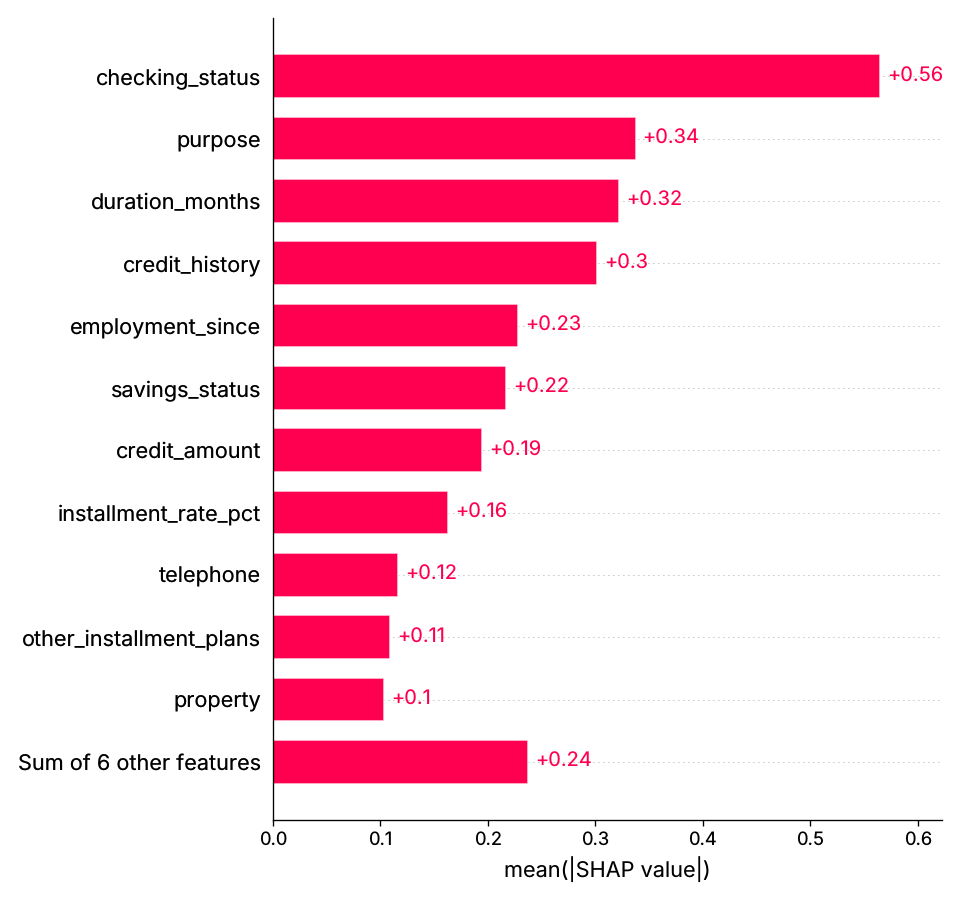

# credit-risk-xgboost-shap

XGBoost credit-default model with SHAP explanations, cost-based thresholding, fairness checks and a model card, on public German Credit data.

## What this is / is not

| | |
|---|---|
| **Reconstructs** | Resume (Jocata, Machine Learning Engineer, Jan 2024 – Jun 2025), verbatim: *"Developed an XGBoost credit risk model with SHAP Explainable AI to meet regulatory validation requirements."* |
| **Is** | A from-scratch reconstruction on **UCI Statlog German Credit** (CC BY 4.0, 1,000 applicants from 1994). All metrics measured here (`docs/EXPERIMENTS.md`). |
| **Is not** | Jocata's model, features, customers or regulator correspondence. No real customer data. "Meets regulatory requirements" is not claimed — see the open items in `docs/MODEL_CARD.md`. |

### Period freeze
Jocata, **cutoff Jun 2025**. Python 3.11; XGBoost 2.1.4 (Feb 2025); SHAP 0.47.2 (Apr 2025); scikit-learn 1.6.1; pandas 2.2.3; matplotlib 3.10.1.
Lock file compiled with `--exclude-newer 2025-06-30`. Details: `docs/DECISIONS.md`.

## Problem
Predict default risk and justify every decision to a validator and to the applicant, without using protected attributes, and show the tradeoffs.

## Architecture
```
german.data ─► decode codes ─► drop protected attrs ─► XGBoost (5-fold CV tuning, monotone constraints)
   ─► OOF probabilities ─► cost-optimal threshold (5:1) ─► test metrics (AUC, PR AUC, KS, Brier, cost, approval)
   ─► SHAP TreeExplainer: global bar + beeswarm, local waterfall + reason codes ─► fairness by sex / age / foreign worker ─► model card
challenger: one-hot + logistic regression, same protocol
```

## Quickstart
```bash
python -m venv .venv && source .venv/bin/activate
pip install -r requirements.txt
pytest -q
python scripts/train_eval.py --out results/metrics.json     # downloads data; writes docs/figures/*.png
```

## Results (test, 5 repeated 70/30 splits)

| Model | ROC AUC | KS | Expected cost / applicant |
|---|---|---|---|
| Logistic regression challenger | 0.792 ± 0.011 | 0.471 | 0.533 |
| XGBoost tuned | 0.797 ± 0.010 | 0.483 | 0.511 |
| **XGBoost tuned + monotone (reported)** | 0.793 ± 0.008 | 0.467 | 0.531 |

Top SHAP drivers: checking account status, purpose, duration, credit history. 

**Fairness finding:** with protected attributes removed, approval-rate ratios are still 0.73 (sex), 0.61 (age < 25), 0.61 (foreign worker), all below the
0.80 four-fifths reference. Including them makes it worse (0.46 / 0.45 for age / foreign worker).

## Limitations
Tiny, old dataset; XGBoost barely beats logistic regression; calibration, drift monitoring, proxy analysis and reject inference are open (MODEL_CARD).

## How to extend
Calibration (isotonic) + reliability plot; fairness mitigation (threshold per group is not legal in many regimes, so look at feature-level proxies);
out-of-time validation on a dataset with dates; reason-code wording reviewed by compliance.
